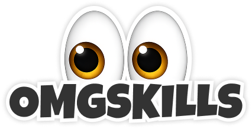

<p align="center">
  
</p>

# omgskills

**Share agent skills with your team.**

OMGSkills helps teams organize and share skills for Claude Code and Codex, alongside a library of useful skills from trusted creators and sources.

[Create sets of skills to share](https://omgskills.com/app/?view=sets) or [explore the library](https://omgskills.com/app/). The web app works on its own; the Mac companion is optional for installing skills and reporting what is installed.

## Share skills with your team

Bring the skills for a project or team together in a Set:

- Organize skills in one place so teammates can find what to use.
- Choose public, invite-only, or only-me access.
- Grant teammates access and share the Set's link. Access can be revoked later.

You can create and share Sets now. Invitations provide a copyable link; they do not send an invitation email.

Teammates install a whole Set from the Mac companion, either at a fixed version or kept updated (the companion shows changes when they open the Set again and asks before applying them).

**Coming soon:** automatic skill updates in the background.

## Find useful skills

Browse the public library without an account. Discover skills through search, collections, trending lists, and creator and company profiles. Read a skill's description, SKILL.md and available README before deciding to use it.

Save useful skills to your library and Sets when signed in. The library complements your team's own skills, giving you a starting point for coding, design, marketing and other work.

"Trusted sources" describes where skills come from, not a guarantee that every skill is safe or security-audited. Review third-party instructions and code before using them.

## Optional Mac companion

Start at [omgskills.com/app/](https://omgskills.com/app/). Browse public skills without an account, organize Sets on the web, and choose a skill to open its Mac installation flow. [Download the Mac companion 0.0.28](https://omgskills.com/download) for Apple silicon and macOS 14 or later, or use the skill's setup panel. The [original Mac app](https://omgskills.com/downloads/omgskills-mac.dmg) and its update feed remain available separately. Existing users are not automatically upgraded.

Connect the companion to your account to see installed skills by Mac and agent, including supported external installs. Sync keeps the installed-skills list up to date; it does not update skill files.

## Use the library from your agent

The read-only MCP server lets agents search the public library, inspect skills and their content, find related skills, and request commit-pinned install plans where available.

Install the npm package:

```bash
npm install -g omgskills-mcp
```

Add it to your MCP client:

```json
{
  "mcpServers": {
    "omgskills": {
      "command": "omgskills-mcp"
    }
  }
}
```

No repository checkout is needed. The MCP server reads public catalog data, not your private library or Sets. It returns install instructions but does not execute them or install skills itself.

See [MCP setup, tools and data sources](mcp/README.md) for hosted access, filters, paging and local configuration.

## Development

This repository contains the web app, catalog pipeline, MCP server and Mac code.

| Directory | Purpose |
| --- | --- |
| `portal/` | React/Vite web app: discovery, personal library, Sets and sharing |
| `netlify/` | Backend functions for the web app, public catalog and connected Macs |
| `index/` | Catalog discovery, metadata, curation and data generation |
| `mcp/` | Read-only MCP server, published as `omgskills-mcp` |
| `menubar/` | Mac companion and original Mac app code |
| `site/` | Public website, hosted data and release assets |
| `scripts/` | Builds, verification, data publication and release tooling |

Use **Node.js 20** for web and MCP development. From the repository root:

```bash
npm ci
npm run dev:portal
```

See [web app setup](portal/README.md) for authentication requirements, public catalog previews and the full local backend. MCP development instructions are in [mcp/README.md](mcp/README.md).

### Builds and releases

- The website and web app ship together. `npm run build:netlify` builds the combined `dist/netlify-site` artifact; do not deploy `site/` directly. Production builds require the configured live Clerk publishable key and prepared release assets.
- Web releases use the guarded [Deploy current main workflow](.github/workflows/deploy-current-main.yml), pinned to the reviewed commit.
- Catalog publication is separate from a web code release. The pipeline publishes versioned data through manifests; do not regenerate the full catalog just to run the web app.
- Mac releases are separate from web and data releases. `menubar/build.sh` creates local development builds, not public signed releases. Public macOS distribution requires Developer ID signing and Apple notarization.
- Publishing a new npm package is a separate release step; a web deployment does not publish it.

## Security and privacy

The public catalog can be browsed without signing in. Sets have their own access controls; public MCP tools do not expose private account data.

With your approval, the Mac companion scans supported local skill folders and reports inventory to your account. Inventory reports include skill metadata and fingerprints, not full local paths or full skill files. See the [privacy policy](https://omgskills.com/privacy/) for details.

Do not commit `.env` files, API tokens, signing certificates, release credentials or private diagnostic logs. Report security issues privately using [SECURITY.md](SECURITY.md).

## License

This repository is **source-available, not open source**. You may inspect and audit it under the [repository license](LICENSE); copying, modifying, redistributing or hosting it requires permission.

The exception is [`mcp/`](mcp/), which is open source under the [MIT License](mcp/LICENSE). Third-party skills retain their own licenses and terms.
