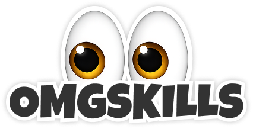

<p align="center">
  
</p>

# omgskills

**Share skills across teams & agents.**

Keep your skills in one place. Use them in Claude, ChatGPT, Cursor, Grok, Muse and more.

[Open omgskills](https://omgskills.com/app/) or [download the Mac app](https://omgskills.com/download) (Apple silicon, macOS 14 or later). The web app works on its own; the Mac app installs skills into Claude Code and Codex.

## Keep your skills in My skills

- My skills holds the skills you write and the ones you add from the library.
- Turn on Sync My skills, and your connected Macs keep a private copy of each skill's files in My skills. You can leave out any skill.
- Add a skill from a GitHub link or a folder on your computer.
- A file that looks like it contains a key or password is not synced unless you confirm it's safe, and a skill with one can't be added.

## Share with your team

Bring the skills for a project or team together in a Set:

- Choose public, invite-only, or only-me access.
- Share the Set's link with teammates. Access can be revoked later. Invitations give you a link to send; they do not send an email.
- Teammates install the whole Set from the Mac app, either at a fixed version or kept updated (the Mac app shows changes when they open the Set again and asks before applying them).

**Coming soon:** automatic skill updates in the background.

## Share with your agents

- **Mac app:** installs skills and Sets into Claude Code and Codex.
- **My skills MCP:** add `https://omgskills.com/my/mcp` as a custom connector or MCP server in Claude, ChatGPT, Cursor, Codex, Grok, Muse or any agent that supports MCP, then sign in to omgskills. The agent can search and read your skills. It is read-only, and you can disconnect any agent under **MCP server** in your account menu.
- **Library MCP:** `https://omgskills.com/mcp` lets agents search the public library, read skills, find related skills and get commit-pinned install plans. No sign-in.

To run the Library MCP locally, install the npm package:

```bash
npm install -g omgskills-mcp
```

Add it to your MCP client:

```json
{
  "mcpServers": {
    "omgskills": {
      "command": "omgskills-mcp"
    }
  }
}
```

The Library MCP reads public catalog data only. It returns install instructions but does not run them or install skills itself. See [MCP setup, tools and data sources](mcp/README.md) for hosted access, filters, paging and local configuration.

## Discover skills

Browse the public library without an account. Find skills through search, collections, trending lists, and creator and company profiles. Read a skill's description, SKILL.md and README before you use it, then add it to My skills or a Set.

"Trusted sources" describes where skills come from, not a guarantee that every skill is safe or security-audited. Review third-party instructions and code before using them.

The [original Mac app](https://omgskills.com/downloads/omgskills-mac.dmg) and its update feed remain available separately. Existing users are not automatically upgraded.

## Development

This repository contains the web app, catalog pipeline, MCP server and Mac code.

| Directory | Purpose |
| --- | --- |
| `portal/` | React/Vite web app: My skills, the library, Sets and sharing |
| `netlify/` | Backend functions for the web app, public catalog, connected Macs and both MCP servers |
| `index/` | Catalog discovery, metadata, curation and data generation |
| `mcp/` | Library MCP server, published as `omgskills-mcp` |
| `menubar/` | Mac app and original Mac app code |
| `site/` | Public website, hosted data and release assets |
| `scripts/` | Builds, verification, data publication and release tooling |

Use **Node.js 20** for web and MCP development. From the repository root:

```bash
npm ci
npm run dev:portal
```

See [web app setup](portal/README.md) for authentication requirements, public catalog previews and the full local backend. MCP development instructions are in [mcp/README.md](mcp/README.md).

### Builds and releases

- The website and web app ship together. `npm run build:netlify` builds the combined `dist/netlify-site` artifact; do not deploy `site/` directly. Production builds require the configured live Clerk publishable key and prepared release assets.
- Web releases use the guarded [Deploy current main workflow](.github/workflows/deploy-current-main.yml), pinned to the reviewed commit.
- Catalog publication is separate from a web code release. The pipeline publishes versioned data through manifests; do not regenerate the full catalog just to run the web app.
- Mac releases are separate from web and data releases. `menubar/build.sh` creates local development builds, not public signed releases. Public macOS distribution requires Developer ID signing and Apple notarization.
- Publishing a new npm package is a separate release step; a web deployment does not publish it.

## Security and privacy

The public catalog can be browsed without signing in. Sets have their own access controls. The Library MCP reads only public data; the My skills MCP reads only your own skills, after you sign in and allow the agent.

With your approval, the Mac app scans supported local skill folders and reports installed skills to your account: names, metadata and fingerprints, not full local paths. With Sync My skills off, no skill files are uploaded. With it on, skill files are kept privately in My skills. See the [privacy policy](https://omgskills.com/privacy/) for details.

Do not commit `.env` files, API tokens, signing certificates, release credentials or private diagnostic logs. Report security issues privately using [SECURITY.md](SECURITY.md).

## License

This repository is **source-available, not open source**. You may inspect and audit it under the [repository license](LICENSE); copying, modifying, redistributing or hosting it requires permission.

The exception is [`mcp/`](mcp/), which is open source under the [MIT License](mcp/LICENSE). Third-party skills retain their own licenses and terms.
