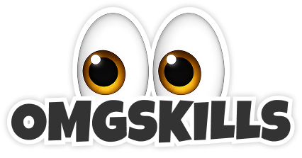

# Web-first rollout

Moves omgskills from a Mac-app-first product to a web-first product with a
companion Mac app. The direction was decided in `connect.md` D3 (2026-10-08):
the web is the whole experience, and the Mac app installs and manages skills.

Updated 2026-10-27. This is the short MVP path: ship the web-first front door
now, measure lightly, and leave the slow work (URL migration, updater tests,
retiring the old app) for after the flip. Traffic is small, so every step is
small, reversible and watched.

---

## 1. Progress

Done and live:

- **Homepage is Discover** (PR #196, commit `70c832fd`, live 2026-10-27).
  - `/` serves a short web-first static page first: headline, search, and
    creator and collection links. The app then takes over into Discover.
  - The address stays `/`, the canonical stays `https://omgskills.com/` and
    the page is indexable. Views reached from it get `/app/...` and `noindex`.
  - The old Mac-first homepage (hero video, features, FAQ) is gone.
  - `/home/` is unchanged and remains the paid-ads landing page.
  - Live check passed: Discover loads, sign-in dialog opens, homepage search
    works, Back returns to `/`, mobile has no sideways scroll, no console
    errors.
  - Rollback: set `takeoverPilotEnabled` to false in
    `config/production-features.json`, or roll back the Netlify deploy.
- **Basic tracking on `/`.**
  - Humblytics runs on the taken-over homepage and follows in-app route
    changes.
  - Key clicks are named: `App Sign In`, `App Get Mac App`,
    `App Setup Download` and `App Install Start`.
  - The X, Reddit and OpenAI pixels still fire there.
- **Account switch safety** (PRs #194 and #195).
  - Moving a Mac to another account removes its inventory from the old
    account.
  - A revoked Mac's skills are hidden.

Committed, waiting for deploy (branch `web-footer`, commit `ce7542c9`):

- **Discover footer.** Discover ends with the site footer, because the
  takeover removes the static page's footer. That keeps the About,
  Developers, llms.txt, Privacy and Terms links for visitors and for crawlers
  that render JavaScript.
- **Footer copy.** Site footers now link `/` as "Discover" and the Mac app as
  `/home/`. The tagline reads "Open web library, free companion Mac app". The
  footers on generated library and skill pages change on the next build.
- **Developers & Agents page in the app.** `/developers/` is taken over like
  the homepage and keeps its address and canonical.
- After deploy, check that `/developers/` shows the app page and that `/` has
  the footer.

Decided along the way:

- **Old Mac app: leave it alone for now.**
  - It has about 4 weekly users.
  - It keeps its download, update feed and data files, and nothing is
    migrated yet.
  - "Get the Mac app" still downloads the old 0.0.20 DMG until step 3.
- **The homepage shipped before the URL migration**, as `urls.md` allows.

---

## 2. MVP path

- [ ] **1. Record the FIN-11 pilot decision** (`newmac.md`): continue,
      revise or stop.
  - It decides whether the 0.0.27 companion is ready to promote in step 3.
- [ ] **2. Finish basic analytics.**
  - [x] Humblytics and named clicks on the taken-over homepage.
  - [ ] Humblytics in the `/app/` shell (`portal/index.html`), so visits that
        start at `/app/` or a shared link are counted too.
  - [ ] A `search` and a `copy_install` event. `copy_install` counts
        visitors without a Mac, which is most paid traffic.
  - [ ] Extend `scripts/check-funnel-health.mjs` with the web funnel: visit,
        search, skill open, install start, setup download, then app connected
        (TelemetryDeck).
- [ ] **3. Make 0.0.27 the default download.**
  - Point `/downloads/omgskills-mac.dmg`, the app's "Get the Mac app" and
    `/home/`'s DMG button at the connected app.
  - Leave `site/appcast.xml` and `/updates/*` alone, so old 0.0.20 installs
    keep working and are not migrated.
  - Note it is Apple silicon only.
- [ ] **4. Web-first copy.**
  - [x] Homepage and footers.
  - [ ] README top section (draft in section 5) and the GitHub repo
        description: "Find, install and manage Claude Code and Codex skills
        from the web, with a companion Mac app."
  - [ ] About, guide and support pages: lead with the web library.
  - [ ] Privacy policy, last dated Aug 14. Add web accounts (Clerk), synced
        Mac inventory, Sets email sharing, device pairing and in-app
        analytics. Say how a user deletes their account and data, even if
        that is "email us" for now.
- [ ] **5. Ship and watch for 2 weeks.**
  - Ship steps 2–4 as one small release on a weekday.
  - Watch Humblytics, Search Console (homepage clicks and indexed pages),
    sign-ins and setup downloads.
  - Roll back if homepage search or sign-ins clearly drop against the weeks
    before 2026-10-27.

Done when: the five steps are checked and two weeks of numbers look no worse
than before the flip.

---

## 3. Later (after the MVP)

- **URL migration** (`urls.md` step 3).
  - Skills move to `/library/owner/repo/skill/`.
  - `/skills/...` and `/collections/...` get one-to-one 301s.
  - Canonicals and sitemaps change in one release.
  - Widen the takeover from the pilot pages to all creator and skill pages in
    batches.
  - Switch `/home/` links from `?view=` to clean paths.
- **Updater tests (G2) and pilot (G3)** for the connected app, then the
  appcast migration that moves 0.0.20 users to the companion.
- **Retire the old app.** Remove the discovery UI, retire
  `/api/portal/catalog-search`, and later remove the "Get the Mac app" CTAs
  and legacy token tabs (`connect.md` Part 3).
- **Polish.**
  - Add the Developers link to the app sidebar.
  - Add a `WebApplication` schema.org entity for the web app.
  - Add CHANGELOG entries for the web app and 0.0.25–0.0.27.
  - Add error reporting in `/app/`.
- **`app.omgskills.com`.** Recommendation: 301 it to `omgskills.com/app/`, so
  there is one origin for sign-in, MCP and SEO.
- **Housekeeping.**
  - Close firewall-hold issues #140, #141 and #183, and stale PRs #49 and #32.
  - Delete merged `codex/*` branches.
  - Move the planning docs out of the repo root.
  - Refresh `newmac.md` and `connect.md` to 0.0.27.

---

## 4. Must keep working

Every step leaves these unchanged. The deploy guards keep checking them.

1. `site/appcast.xml` and `/updates/*` (old app updates).
2. `/downloads/omgskills-mac.dmg` and `/download` (old posts and ads link
   here; step 3 changes what they serve, not the URLs).
3. `/data/manifest.json` and the hashed data files (old app refreshes daily).
4. The MCP endpoint and the `omgskills-mcp` npm package.
5. Static SEO URLs and sitemaps. Any move gets a 301, never a 404.
6. Sign-in, Sets share links and device pairing (`/app/connect`).

---

## 5. README top section (draft)

Replaces everything above "MCP server" in `README.md`.

```markdown
<p align="center">
  
</p>

# omgskills

**Find, install and manage agent skills for Claude Code and Codex.**

omgskills is an open web library of skills from trusted creators, at
[omgskills.com](https://omgskills.com). Search the catalog, read each skill's
SKILL.md and README, follow creators and collections, and save skills into
Sets you can share with your team.

The free **omgskills Mac app** is the companion that does the local work: it
installs the exact version you picked on the web, keeps it updated, and shows
the web which skills are installed on which Mac and agent. Public installs
need no account.

- **Web library:** https://omgskills.com
- **Mac companion:** https://omgskills.com/download (macOS 14+, Apple silicon)
- **For agents:** `npm install -g omgskills-mcp` (see below)
```

---

## 6. Open questions

1. FIN-11: continue, revise or stop?
2. Is Apple silicon only acceptable for the default download?
3. What do visitors without a Mac get from Install: the copy command, MCP, or
   both?
4. Should the ad pixels run inside the signed-in app, or only on public
   pages?
